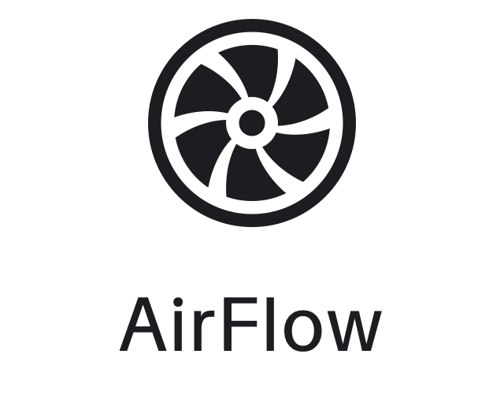
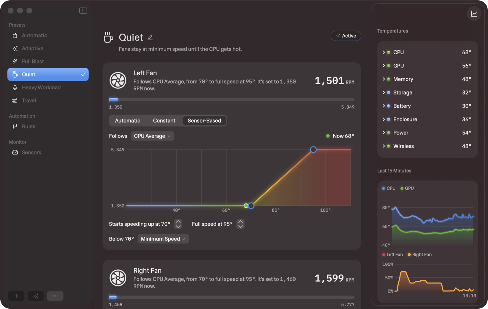
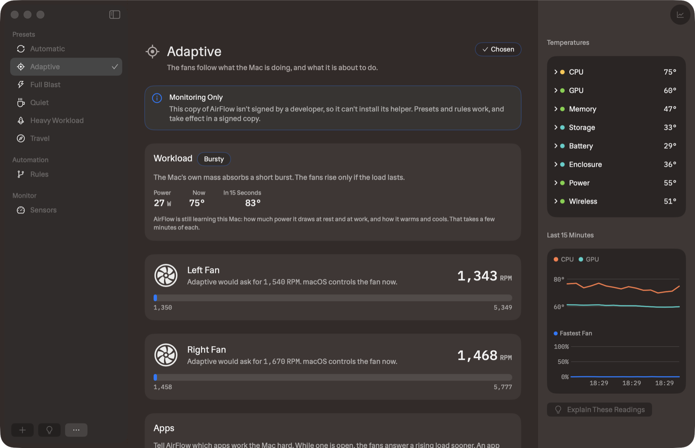
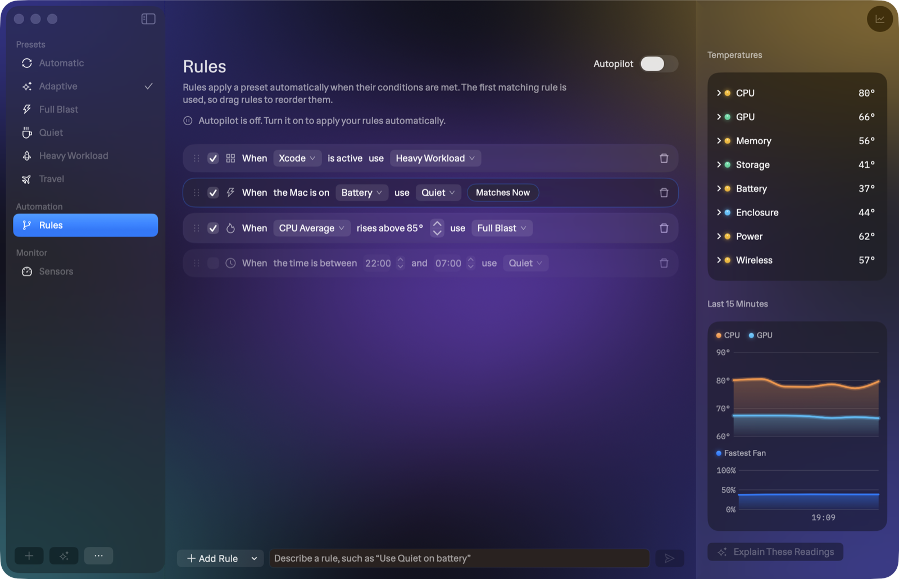
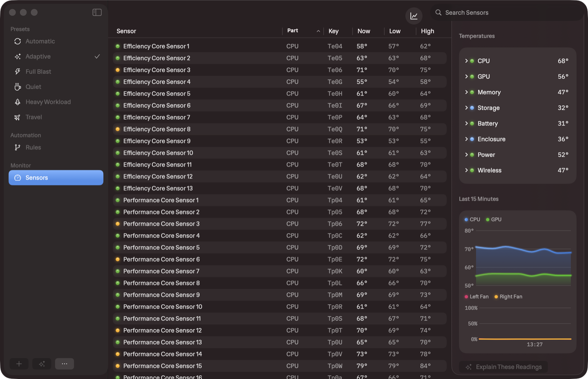

<h1 align="center">
  <picture>
    <source
      srcset="docs/images/airflow-brand-dark.png"
      media="(prefers-color-scheme: dark)"
    />
    
  </picture>
</h1>

<p align="center"><em>Your Mac's fans, set the way you want them.</em></p>

AirFlow shows every fan and temperature sensor in your Mac and lets you control each fan. You can save any number of presets and change between them from the menu bar. You can also describe a preset in plain words, and Apple Intelligence drafts it on your Mac.

AirFlow requires macOS 26 or later and a Mac with Apple silicon.

<p align="center">
  <picture>
    <source
      srcset="docs/images/preset-curve-dark.png"
      media="(prefers-color-scheme: dark)"
    />
    
  </picture>
</p>

<table>
  <tr>
    <td width="33%">
      <a href="docs/images/adaptive.png">
        
      </a>
    </td>
    <td width="33%">
      <a href="docs/images/rules.png">
        
      </a>
    </td>
    <td width="33%">
      <a href="docs/images/sensors.png">
        
      </a>
    </td>
  </tr>
  <tr>
    <td><strong>Adaptive</strong><br />The fans follow what your Mac is doing and the temperature it expects in 15 seconds.</td>
    <td><strong>Rules</strong><br />A preset changes when an app is active, on battery, when a part gets hot, or at a time of day.</td>
    <td><strong>Sensors</strong><br />Every temperature sensor your Mac reports shows its lowest and highest reading.</td>
  </tr>
</table>

The pictures show a copy of AirFlow that no developer signed. That copy monitors the fans and can't change their speed, so each page says Monitoring Only.

## Features

### Fans and sensors

- AirFlow reads each fan's speed, its minimum, and its maximum, and the temperature of every sensor your Mac reports.
- The Sensors page lists each sensor with its part, its SMC key, and its current, lowest, and highest temperature since AirFlow opened. You can search the list and sort it by any column.
- AirFlow groups sensors by part: CPU, GPU, Memory, Storage, Battery, Enclosure, Power, and Wireless. The inspector shows one temperature for each part and a chart of the last 15 minutes. The readings update every second while you look at them.
- The menu bar item shows the fastest fan, the CPU temperature, the GPU temperature, the fastest fan with the CPU temperature, or the icon alone. Click it to see every fan and to change presets.
- Temperatures use Celsius or Fahrenheit, and you can show tenths of a degree.

### Fan control

- Each fan can be Automatic (macOS controls it), Constant (one speed), or Sensor-Based (the fan follows a sensor between two temperatures).
- A sensor-based fan follows the average or the hottest sensor of a part, or one sensor that you choose.
- AirFlow draws a sensor-based fan as a curve with the sensor's current temperature marked on it. Drag the two handles to change where the fan starts to rise and where it reaches full speed.
- Each fan in a preset can run in its own way.

### Presets

- You can keep as many presets as you want. AirFlow starts with Automatic, Adaptive, Full Blast, Quiet, Heavy Workload, and Travel.
- A preset has a name, an icon, and a one-line summary. A new preset starts as a copy of the one you selected, and changing a preset never changes another one.
- AirFlow stores presets as a YAML file that you can read and edit. See [The presets file](#the-presets-file).
- You can export presets to a `.yaml` file and import them on another Mac. An import never replaces a preset you have.

### Adaptive

- Adaptive runs the fans by what your Mac is doing and by the temperature it expects in 15 seconds.
- For light work it keeps the fans at their minimum while the forecast is under 80 °C. It lets a short burst pass, and it raises the fans early for a long load.
- It learns how your Mac warms and cools while it runs, and it keeps no history of readings.
- You can tell it which apps work your Mac hard, and Apple Intelligence can suggest what an app is known for. See [How Adaptive decides](#how-adaptive-decides).

### Rules and Autopilot

- Rules change presets for you: when an app is active, when your Mac is on battery, when a part gets hot, or at a time of day.
- The first rule that matches wins, and you drag the rules into the order you want.
- Rules do nothing until you turn on Autopilot. A preset that you choose yourself holds until a different rule matches.

### Apple Intelligence

- Describe a preset or a rule, such as "Stay quiet until the CPU reaches 80°", and the model on your Mac drafts it. You decide whether to keep it.
- Click Explain These Readings, and the model says in plain words what the recent temperatures and fan speeds show.
- The model never changes a fan. Nothing you type and no reading leaves your Mac.

### Siri and Shortcuts

- Ask Siri to "Apply Quiet in AirFlow" or "What are my fans doing in AirFlow".
- The Apply Fan Preset and Get Fan Status actions work in Shortcuts and Spotlight.

### Safety

- A small helper changes fan speeds. It accepts requests only from AirFlow and keeps every speed between the fan's own minimum and maximum.
- The helper returns the fans to macOS when AirFlow quits or stops responding.
- The safeguard returns the fans to macOS when the CPU or the GPU runs past a limit that you choose. See [Fan control and safety](#fan-control-and-safety).

### Updates

- AirFlow checks for a newer version by itself and installs it when you agree. Every update is signed, and AirFlow refuses one that isn't.

### Design

- AirFlow uses Liquid Glass throughout, follows Light Mode and Dark Mode, and uses your accent color.
- It shows fan speeds and temperatures in a monospaced font, so a number that changes doesn't move the text beside it.
- The drawn animations hold still when Reduce Motion is on.

## Using AirFlow

| To do this | Do this |
| --- | --- |
| Set up AirFlow | The first time AirFlow opens, it asks for fan control, opening at login, and automatic updates in one place. Turn on what you want, then click Continue. Once fan control is on, it suggests the Adaptive preset. |
| Change presets | Click the fan in the menu bar, then click a preset. |
| Open the window | Click the fan in the menu bar, then click Open AirFlow. |
| Change how a fan runs | Select a preset you made in the sidebar. Click Automatic, Constant, or Sensor-Based under the fan. |
| Change a fan curve | Drag either handle on the curve, or click the arrows beside "Starts speeding up at" and "Full speed at". |
| Use a preset | Select it in the sidebar, then click Apply. |
| Make a preset | Click the Add button at the bottom of the sidebar. The new preset starts as a copy of the selected one. |
| Describe a preset | Click the sparkles at the bottom of the sidebar. |
| Rename a preset | Click the pencil beside its name. |
| Export or import presets | Click the More button at the bottom of the sidebar, or choose File > Export Presets or File > Import Presets. |
| Add a rule | Click Rules in the sidebar, then click Add Rule. Drag a rule to change its place. The first rule that matches wins. |
| Let rules run | Turn on Autopilot on the Rules page. |
| Turn on fan control | Click Turn On Fan Control. System Settings opens with a small AirFlow panel beside it that says what to do: turn on the switch next to AirFlow under Allow in the Background. AirFlow notices when you do. |
| Open AirFlow at login | Choose AirFlow > Settings > General, then turn on Open at Login. |
| Check for an update | Choose AirFlow > Check for Updates, or click Check for Updates in Settings > About. |

## How Adaptive decides

One curve is either too loud for light work or too late for a long load.

First, Adaptive works out what kind of work your Mac is doing. It reads the power your Mac draws, as a share of what your Mac draws between rest and full load, over 5 and 30 seconds. It also knows which open apps work a Mac hard, such as Final Cut Pro, Lightroom, or Ollama. You can add your own on the Adaptive page, and Apple Intelligence can suggest what an app is known for. A suggestion counts only after you accept it.

| Work | What it means | What the fans do |
| --- | --- | --- |
| Light | Browsing, writing, coding | They stay at their minimum until the forecast passes 80 °C. |
| Bursty | A photo filter or a build: seconds of load | Your Mac's own mass takes up the burst. The fans rise only if the average load over 15 seconds stays high. |
| Sustained | A video export or a local language model: a high average load over 30 seconds, or a few seconds of load while a known app is open | The fans rise to at least 30% of their range before the heat arrives, and then hold steady. |

Second, it forecasts the temperature 15 seconds ahead for each speed it could choose. It takes the speed that best balances heat against noise for that kind of work. The forecast is fitted to your Mac while it runs. Until the fitted forecast is closer than the recent trend, the trend counts for more. AirFlow keeps the fitted coefficients and no history of readings.

Four limits hold whatever Adaptive decides:

- Above 85 °C, heat counts ten times as much, so a long load stays under the temperature where the chip slows itself down.
- A jump in pitch is easier to hear than steady air. So the speed rises no faster than 150 RPM a second (300 for a long load) and falls no faster than 100.
- The fans fall only after Adaptive has wanted a lower speed for 20 seconds, so they don't rise and fall between two prompts or two edits.
- Adaptive never asks the fans for less than a fixed line gives at the present temperature: nothing at 80 °C, full speed at 92 °C. What Adaptive has learned can't lower it. The safeguard below still returns the fans to macOS.

A copy of AirFlow that can't control fans still shows the speed Adaptive would set.

## Fan control and safety

Reading fans and sensors needs no permission. Changing a fan's speed does, so AirFlow uses a small helper that runs as an administrator. You can decline the helper and use AirFlow to monitor only.

- The helper accepts requests only from a copy of AirFlow that the same developer signed.
- The helper keeps every speed between the fan's own minimum and maximum.
- The helper returns the fans to macOS when AirFlow quits, when AirFlow stops responding for 30 seconds, and when your Mac shuts the helper down.
- The safeguard returns the fans to macOS when the average CPU or GPU temperature reaches a limit you choose (95 °C at first), until the temperature falls 8 degrees below it.

Changing fan speeds changes how your Mac cools itself. You are responsible for the settings you choose. Quit other fan control software before you use AirFlow, because two apps that set the same fan work against each other.

## Privacy

AirFlow doesn't collect any data. Its one network connection is the check for a newer version, which reads a list of releases from GitHub and sends nothing about you or your Mac. You can turn the check off in Settings > About. Apple Intelligence runs on your Mac. Your presets and rules, the apps you told Adaptive about, and the coefficients Adaptive has learned are stored in your Library folder. You can delete them there at any time.

## The presets file

AirFlow keeps your presets in `~/Library/Application Support/AirFlow/presets.yaml`. An exported file has the same format:

```yaml
airflow: 1
presets:
  - name: Quiet
    icon: coffee
    summary: Fans stay at minimum speed until the CPU gets hot.
    fans:
      mode: sensor
      sensor: cpu average
      start: 70
      full: 95
    overrides:
      - fan: 2
        mode: constant
        rpm: 3200
```

| Key | Meaning |
| --- | --- |
| `fans` | How every fan runs. |
| `overrides` | A different setting for one fan. Fans are counted from 1. |
| `mode` | `automatic`, `constant`, or `sensor`. |
| `rpm` or `percent` | For `constant`: a speed, or a share of the fan's range from 0 to 100. |
| `sensor` | For `sensor`: a part and `average` or `hottest`, such as `gpu hottest`, or `key` and an SMC key, such as `key TaLP`. The parts are `cpu`, `gpu`, `memory`, `storage`, `battery`, `enclosure`, `power`, and `wireless`. |
| `start` and `full` | For `sensor`: the temperatures, in degrees Celsius, where the fan starts to rise and where it reaches full speed. |

AirFlow checks every value in a file it reads. A number outside its range is moved into range, and a file that AirFlow can't read is refused with the reason. An imported preset never replaces one you have: it gets its own name. If the presets file itself can't be read, AirFlow sets it aside as `presets.yaml.unreadable` and starts again with the presets it ships with.

## Requirements

- macOS 26 or later, on a Mac with Apple silicon
- Apple Intelligence, for drafting presets and rules and for explaining readings. Everything else works without it.
- To build AirFlow: Xcode 26 or later, [Rust](https://rustup.rs), and [XcodeGen](https://github.com/yonaskolb/XcodeGen) (`brew install xcodegen`)

## Building AirFlow

```
scripts/build.sh
open build/DerivedData/Build/Products/Debug/AirFlow.app
```

A plain build is signed ad hoc. It monitors, and it keeps presets and rules, but it can't install the helper, because the helper trusts only an app that a developer team signed. To build a copy that can control fans, sign it with a developer identity from your keychain:

```
scripts/build.sh --sign
```

To run the tests:

```
scripts/test.sh
```

The tests never read or change a real fan. The backend's tests use a made-up SMC, and the app's tests use a recorder in place of the helper.

The backend is Rust, in `backend/`. It reads the SMC, names the sensors, sets fan speeds, and is the helper. The app is Swift and SwiftUI, in `AirFlow/`, and links the backend through a C interface. XcodeGen generates the Xcode project from `project.yml`, and the repository doesn't include it.

AirFlow uses Swift Package Manager and Cargo for its dependencies. [Lottie](https://github.com/airbnb/lottie-ios) plays the animations, [Yams](https://github.com/jpsim/Yams) reads YAML, and [Sparkle](https://github.com/sparkle-project/Sparkle) installs updates. The backend uses [block2](https://github.com/madsmtm/objc2) and [libc](https://github.com/rust-lang/libc). `scripts/make-animations.py` generates the animation files, and `scripts/make-icons.py` writes the icons.

## License

AirFlow is free software under the GNU Affero General Public License, version 3. See [LICENSE](LICENSE). You can use, change, and share AirFlow. If you give anyone a copy, changed or not, you must also give them its source under the same license. AirFlow comes with no warranty.

Text is set in [Hedvig Letters Sans](https://github.com/KanonFoundry/HedvigLetters) and readings in [IBM Plex Mono](https://github.com/IBM/plex), both under the SIL Open Font License 1.1. The app icon, the menu bar icon, and the turning fan use the fan from [Bootstrap Icons](https://github.com/twbs/icons), under the MIT License. Every other icon is from [Ant Design Icons](https://github.com/ant-design/ant-design-icons), under the MIT License. [Lottie](https://github.com/airbnb/lottie-ios) is licensed under Apache 2.0. [Sparkle](https://github.com/sparkle-project/Sparkle), [Yams](https://github.com/jpsim/Yams), [objc2](https://github.com/madsmtm/objc2), and [libc](https://github.com/rust-lang/libc) are licensed under the MIT License. The [licenses/](licenses) folder contains each license, and the app carries a copy of that folder.

© 2026 Kevin Chen.
